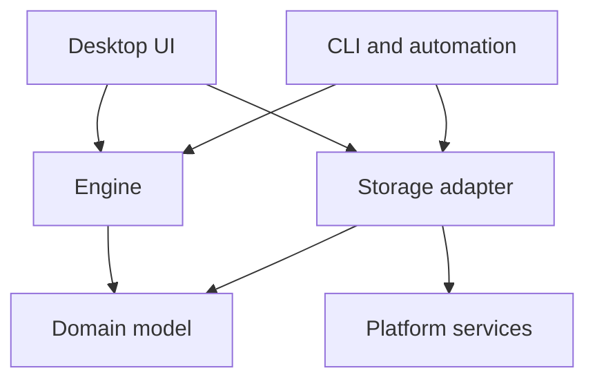

# Rust Application Development Guide for Coding Agents

Version 1.0 · 8 October 2026

Build ambitious Rust applications through small, verifiable changes. Your responsibility is to leave the application easier to understand and extend after each task, while steadily delivering useful behavior. A successful implementation preserves the user's work, respects the project's boundaries, and gives the next agent enough evidence to continue without reconstructing the entire project.

Read this guide before bootstrapping a project. Then create a short, project-specific `AGENTS.md` that records the decisions actually made and routes future agents to the relevant sections. Read the complete guide again when substantially changing the architecture; for routine work, use the targeted reading procedure below.

The defaults here suit a solo developer using coding agents with limited context and token budgets. Adapt them to the application's requirements. “Must” identifies a constraint needed to preserve correctness, user data, or an explicit project decision. “Default” identifies a starting choice that may be changed for a stated reason. “Consider” identifies a technique to introduce when a concrete need appears. Record consequential departures briefly; do not create paperwork for routine implementation choices.

## Purpose and lessons from ArtCraft

The most transferable lessons from the ArtCraft projects are architectural boundaries, executable checks, consistent interface design, and honest evidence about what works. Their current repositories are useful examples of engineering discipline in developing applications. The apps are described as early alpha or in development; visual polish and feature coverage alone do not establish production readiness. [A1]

PhotoCraft's agent instructions specify dependency layers, an engine shared by several interfaces, visual verification, and session records. VectorCraft adds a repeatable task cycle and checks for attributed assets. FilmCraft emphasizes protecting unsaved projects and isolating platform-specific integration. These are practices to adapt, rather than a reason to reproduce their entire repository layout. [A2] [A3] [A4]

PhotoCraft's UI guidance describes a token system, shared widgets, consistent fonts and icons, and visual checks across themes and window sizes. Its scorecard distinguishes measured behavior from menu coverage and records incomplete or over-budget scenarios. Those practices provide a stronger model for development than counting implemented features. [A5] [A6]

The engineering recommendations that follow are a synthesis for independent projects. Choose the UI stack, number of crates, supported platforms, and automation surface for the actual app. ArtCraft's Rust-only policy, product naming, clean-room implementation rules, and separation of its app repositories are project-specific decisions, not universal Rust requirements.

## Define the smallest useful application before coding

Start by writing a compact product brief in `docs/product.md`. Identify the intended user, the job the app helps them do, and one end-to-end workflow that would justify opening it. State the first release's supported inputs, outputs, and operating systems. State which attractive features are deferred. A sentence such as “Import a local dataset, inspect its records, edit one field, and save a project that reopens correctly” is much more useful than “Build a powerful research platform.”

Separate the long-term ambition from the current milestone. The ambition can describe a sophisticated editor, mapping environment, simulation, or document workbench. The first milestone should exercise the essential architecture through one narrow workflow. Define completion through observable behavior, including a representative failure, rather than through a collection of screens or modules.

Identify risks before choosing abstractions. File fidelity, large datasets, text shaping, rendering latency, platform integration, and collaboration have different architectural consequences. Investigate the highest-risk assumption with a bounded experiment when necessary. Give the experiment a question, a success criterion, and an outcome. Promote useful code deliberately; remove or isolate the remainder so it does not become a second implementation accidentally.

Maintain one active feature task by default. Capture new ideas in a backlog with enough detail to recover their intent, then continue the current task. An appealing suggestion is not authorization to expand the milestone. If a discovery changes the product direction or makes the promised behavior impractical, explain the tradeoff and seek the owner's decision; make routine reversible implementation choices independently.

## Make the repository the durable source of context

The repository must contain the information required to build, verify, and extend the application. Chat history can explain how a decision arose, but it must not be the only record of an architectural contract, a known limitation, or unfinished work. Code and successful checks establish implemented behavior. Specifications establish intended behavior. Keep disagreements between the two visible.

Use a small documentation set with distinct responsibilities. The filenames below are defaults; equivalent existing files are preferable to a second set of documents.

| File | Responsibility |
| --- | --- |
| `AGENTS.md` | Give the entry instructions, exact commands, major constraints, and links for further reading. Keep it short enough to read at every session. |
| `README.md` | Explain the app, the simplest build and run path, and its current limitations for a new user or contributor. |
| `docs/product.md` | Define users, supported workflows, the current milestone, and explicit deferred scope. |
| `docs/architecture.md` | Map modules or crates, dependency direction, state ownership, public entry points, and the important extension paths. |
| `docs/status.md` | Record the current checkpoint, active task, relevant verification, unresolved problems, and next action. |
| `docs/tasks/` | Hold bounded task specifications once work needs more detail than the status file. Create task files as needed. |
| `docs/decisions/` | Explain consequential architectural decisions and their tradeoffs. Add records when decisions occur. |
| `docs/ui.md` | Record interface tokens, reusable components, and interaction conventions once a GUI is being built. |

Do not create all optional documents as empty scaffolding. Bootstrap the first five files with concise, real content. Add a task file for the first substantial implementation. Record the initial UI choice and dependency direction in the architecture document; a separate decision record becomes useful when the rationale needs to survive alternatives or later changes.

Give every fact one canonical home. `AGENTS.md` should point to the architecture map rather than repeat it. A task should link to the performance budget rather than quote a second copy. Generated inventories should identify their source and regeneration command. When a decision changes, update the authoritative record and remove conflicting instructions in the same task.

The status file is a current handoff, not an accumulating transcript. Keep recent history in Git, issues, or a separate development log if useful. Commit durable project context so it follows the checkout and survives machine changes. Keep personal scratch research, secrets, and bulky transient logs outside committed documentation. This deliberately favors portable handoffs over local-only planning files.

In the architecture map, identify the concrete entry point for each common extension: adding an edit, adding an importer, adding a background job, and adding a UI panel. Name the responsible package, principal API, and relevant test suite. For example, a record-renaming task should lead directly to the core's validated rename operation, its callers, and its operation tests. A new durable field should additionally lead to the file conversion and migration tests. Update these routes when code moves; this is more useful to a new agent than an exhaustive catalog of every function.

## Orient each agent through progressive disclosure

At the beginning of a session, read the root `AGENTS.md`, `docs/status.md`, and the active task. Establish the checkout and inspect `git status` before editing. Read the architecture overview only far enough to identify the responsible module, its callers, and its dependencies. Then read applicable local instructions, the relevant implementation, and the tests that define its behavior.

Search before broad reading. Use `rg` to find an API, command identifier, or type, and `rg --files` to locate files. Follow the call path around the requested behavior rather than dumping the repository into context. Expand the investigation when evidence shows that the behavior crosses another boundary. A document-wide refactor or new storage model justifies wider orientation; a small command fix usually does not.

Use local `AGENTS.md` files only where instructions truly differ, such as a parser crate with corpus requirements or a UI package with screenshot procedures. Document how the chosen agent harness discovers nested instructions; do not assume every harness loads them automatically. Keep requirements compatible with the root file and avoid several near-duplicate instruction systems for different models. A small adapter file may point another harness to the same canonical instructions.

Before a long session loses context, write a concise checkpoint: current task, base commit, changed files, implemented behavior, commands run and their outcomes, remaining uncertainty, and the exact next action. Record partial work honestly. The next agent must inspect the working tree and the code rather than treating a previous agent's summary as proof.

## Establish a small Rust workspace with a real boundary

For an application intended to grow, default to a workspace containing one headless core library and one application shell. Keep responsibilities inside those packages as modules initially. This gives the compiler a useful dependency boundary without requiring a large crate hierarchy.

| Initial path | Responsibility |
| --- | --- |
| `Cargo.toml` | Define workspace membership, shared package settings, dependencies when useful, and lint policy. |
| `Cargo.lock` | Record the resolved application dependencies; commit it. |
| `rust-toolchain.toml` | Pin the selected toolchain and required components after verifying the initial build. |
| `crates/app-core/Cargo.toml` | Declare the core's dependencies, which exclude the GUI framework. |
| `crates/app-core/src/lib.rs` | Expose the small public API; place substantive behavior in cohesive modules. |
| `apps/desktop/Cargo.toml` | Depend on the core and the chosen UI or platform libraries. |
| `apps/desktop/src/main.rs` | Initialize services, start the shell, and connect it to the core. |
| `.github/workflows/ci.yml` | Run the baseline verification commands if GitHub is the hosting platform. |

A one-package project with a library and binary is appropriate for a throwaway experiment or a very small utility. Move to separate packages when dependency isolation becomes useful. Rust modules enforce visibility, but they cannot prevent a module from using GUI dependencies already available to its package; a separate core package can.

For a current Rust 2024 workspace, the following is a minimal manifest pattern. Set names and package metadata for the actual project. Verify the selected dependencies and toolchain before adopting it. Cargo supports shared package settings and workspace lints, but members must explicitly inherit them. [R1]

```toml
# Cargo.toml
[workspace]
members = ["crates/app-core", "apps/desktop"]
resolver = "3"

[workspace.package]
version = "0.1.0"
edition = "2024"
publish = false

[workspace.lints.rust]
unsafe_code = "forbid"

[workspace.lints.clippy]
dbg_macro = "warn"
todo = "warn"
```

```toml
# crates/app-core/Cargo.toml
[package]
name = "app-core"
version.workspace = true
edition.workspace = true
publish.workspace = true

[lints]
workspace = true
```

```toml
# apps/desktop/Cargo.toml
[package]
name = "app-desktop"
version.workspace = true
edition.workspace = true
publish.workspace = true

[dependencies]
app-core = { path = "../../crates/app-core" }

[lints]
workspace = true
```

These manifests describe structure, not a complete application. Add the chosen UI dependencies to the shell, create the source targets, and generate the lockfile during bootstrap. Select an exact tested toolchain for reproducibility. If supporting a minimum Rust version matters, record `rust-version` and test that version separately; an edition setting does not prove that all dependencies support the minimum.

Prefer explicit member paths while the workspace is small. A glob is reasonable later, provided package creation never exposes a half-written manifest. Add no empty engine, renderer, storage, protocol, plugin, or platform crates in anticipation of future requirements.

## Keep domain logic independent of its interfaces

The core owns the application's meaning: documents or datasets, invariants, operations, validation, and the outcomes of changes. The UI owns presentation and interaction. Storage adapters translate durable data into domain objects. Platform services handle operating-system concerns. These may begin as modules, but their responsibility boundaries should already be legible.

The conceptual dependency direction below applies when those responsibilities become separate packages. Arrows mean “depends on,” not “sends an event to.” Engine and model may initially share `app-core`; storage and platform code may initially live in the shell.



The domain model must not depend on window handles, widgets, DOM elements, Tauri state wrappers, or GPU resources. Engine APIs should accept domain values and return meaningful outcomes. A domain operation must be exercisable without opening a window. Transport-specific serialization and GUI-framework types belong at adapters.

Keep the public core API narrow. Make fields private when arbitrary mutation could break invariants, and expose validated construction or operations. Prefer domain names such as `Project`, `RecordId`, and `ImportOptions` to vague `Manager` or `Context` types. Use `pub(crate)` and module privacy before expanding the public API. Avoid wildcard re-exports that obscure ownership.

Use a small number of concrete services before introducing traits. A trait is useful when two implementations exist, a platform boundary needs substitution, or a critical failure needs injection in a test. A trait for every struct adds indirection without establishing a meaningful boundary. Keep units, coordinate spaces, identifier types, and ordering rules explicit; a newtype can prevent a milliseconds-versus-seconds mistake more cheaply than a framework.

Cargo prevents cycles between packages, but it does not prevent every architectural inversion. When additional packages create real risk, add a dependency-policy check based on `cargo metadata`. Check workspace edges and prohibited UI or platform dependencies, including relevant build and target-specific edges. Give development-only test dependencies an explicit policy. Run the check in CI so the diagram and the actual dependency graph remain consistent.

## Choose the UI stack for the application

An all-Rust stack is attractive when custom canvases, image processing, simulations, or GPU resources dominate the application. egui provides the immediate-mode interface, eframe supplies the application framework, and wgpu can supply GPU rendering. egui widgets are custom drawn; compiling to native code does not make them operating-system widgets. [R2]

Tauri is attractive when rich text, web layouts, forms, maps, existing browser libraries, or web frontend expertise make the product easier to build. It combines a Rust backend with a WebView frontend and message passing. Preserve the same core boundary in either stack. Using a WebView does not imply weak architecture or inherently poor performance. [R3]

Record the choice and its concrete rationale. Account for accessibility, text entry and IME, keyboard behavior, packaging, updates, system dialogs, and the planned visual design as well as raw rendering speed. Test a representative interaction before committing to a stack when one of those requirements is uncertain. Default to one UI implementation; maintaining two shells is justified only by an actual product requirement or migration.

With egui, keep the frame or update function focused on presenting state and interpreting input. Start an operation in response to an interaction, not on every repaint. Schedule long work outside the frame, apply its result through the engine, and request a repaint when results arrive. Retain caches, texture handles, and widget identifiers deliberately rather than rebuilding them incidentally. Virtualize large lists and avoid scanning the entire document each frame.

With Tauri, commands should translate validated request DTOs into the same core operations used by tests and other adapters. A DTO is the transport's data-transfer object, not the authoritative document. Define response and error shapes, preferably generating frontend types from a canonical schema or testing the contract if types are maintained separately. Tauri supports fallible commands returning `Result`. [R4]

Keep authoritative document state and invariants in Rust unless a requirement explicitly assigns them elsewhere. The frontend can own selection, draft form values, and optimistic display state with a documented reconciliation rule. Use stable IDs and revisions for asynchronous responses. Avoid duplicating business rules in JavaScript and Rust, sending whole projects over IPC on every interaction, or exposing arbitrary backend execution as an API.

## Give state a clear owner and changes a clear path

Classify state by lifetime and authority. Durable domain state belongs to the document or project. Session state includes the active document, selection, jobs, and history when those are application concepts. View state includes zoom, panels, focus, and temporary text fields. Derived state includes previews, search indexes, and caches that can be rebuilt. Persist user preferences separately from project contents unless they are genuinely part of the project.

Default to one owner of mutable document state. For a desktop app this is often the engine on the main thread or a dedicated engine task. Workers receive immutable snapshots or bounded inputs and return candidate results. They should not hold a document lock while performing long computation or waiting on I/O. Add synchronization where sharing is real; do not distribute `Arc<Mutex<_>>` throughout the application to avoid deciding who owns a value.

Route durable user-visible edits through an operation API. Start with typed Rust functions or a small command enum. A command records an intent, validates its inputs and preconditions, and returns a result that describes the change. UI controls, keyboard shortcuts, CLI tools, and later automation should call this same behavior. A JSON registry is optional; do not replace useful Rust types with dynamic JSON throughout the core.

For an editor, define the distinction between queries, durable edits, and view-only actions. Give durable edits a transaction boundary: validate, prepare, commit, then update history and dirty state. For a small model, preparing a cloned candidate is acceptable. For large data, introduce deltas, structural sharing, or an explicit transaction only when measurements show that cloning is costly. A failed operation must leave the prior valid document usable.

If undo is required, design it with the first meaningful edit. A simple bounded snapshot history is a valid beginning. Record what counts as one step: a completed brush stroke, a committed text-edit session, or a single accepted dialog, rather than every intermediate pointer event. Preview and cancel must have explicit semantics. Test edit–undo–redo and failure paths before extending the command set. Applications without editing need not acquire an undo framework.

Separate in-memory edits from external effects. Saving, publishing, exporting, and network actions are not automatically reversible by an undo entry. Make retries and duplicate execution deliberate. Add idempotency keys or revision preconditions when a transport or job system can repeat requests; a local synchronous button callback alone does not need a distributed transaction design.

## Protect persistence and evolve formats deliberately

If the app owns project files, saving and reopening are part of the first useful workflow. Define a versioned on-disk representation and keep it distinguishable from the in-memory model. Serializing a runtime struct directly is reasonable for a prototype, but do not accidentally make every implementation detail a permanent file-format contract. Document which fields are durable, derived, transient, or intentionally omitted.

Use explicit conversion at important persistence boundaries. Exhaustive destructuring without `..` forces a conversion to be revisited when a domain struct gains a field. Exhaustive construction forces required output fields to be supplied. This is a compiler tripwire for omissions, not proof of semantic fidelity. For example:

```rust
struct Document {
    title: String,
    notes: Vec<String>,
}

struct FileDocument {
    schema_version: u32,
    title: String,
    notes: Vec<String>,
}

fn into_file(document: Document) -> FileDocument {
    let Document { title, notes } = document;
    FileDocument {
        schema_version: 1,
        title,
        notes,
    }
}
```

Adding a field to `Document` now breaks this destructuring until its persistence treatment is chosen. Apply the technique to relevant nested types as well; one exhaustive top-level conversion cannot detect omissions inside arbitrary helper functions. Retain round-trip and migration tests because a conversion can compile and still save the wrong value.

Add defaults only when they preserve the intended meaning of an older file. An empty tag list may be a sensible default; an invented timestamp or a zero-valued coordinate system may not be. Serde's `#[serde(default)]` supplies a value when a field is absent; it does not design or validate a migration. [R5] For renames, changed units, reorganized structures, or changed invariants, use an explicit migration and old-version fixtures.

Define the forward-compatibility policy too. Reject an unsupported newer native schema with a useful error, open it read-only if supported, or preserve unknown data through a deliberate mechanism. Do not quietly drop fields and then overwrite the source. In third-party formats, distinguish byte fidelity, semantic fidelity, and rendered fidelity. Preserve unknown blocks when feasible, and report lossy conversions before the user replaces an original.

Default to writing a new temporary file beside the destination and replacing the destination only after writing succeeds. Use a platform-appropriate replacement strategy, and test replacement of an existing file. Flush buffered output and use synchronization where the application's durability promise requires it; atomic visibility and survival of power loss are different guarantees. A temporary file on another filesystem can defeat the intended replacement behavior.

Mark a document clean only for the revision actually saved. If the user edits during a background save, the newer document remains dirty. Give autosave or recovery files their own locations, retention policy, and format version; never present them as a successful manual save. If multiple instances can write the same project, define conflict detection or locking before silently allowing last-writer-wins behavior. For a database, use transactions and versioned schema migrations with similarly explicit failure behavior.

Test interrupted or failed writes, malformed files, unsupported versions, and save–reopen fidelity with small synthetic data. A disk-full or permission failure must preserve the previous valid file and communicate what remains unsaved. Recovery should itself be testable, and recovery data should remain available until a successful save or an explicit discard.

## Use Rust to make invalid behavior difficult

Represent mutually exclusive states with enums and encode important distinctions in types. A job should have a meaningful `Queued`, `Running`, `Completed`, `Failed`, or `Cancelled` state rather than several booleans that permit contradictions. A document ID, object ID, revision, screen point, and world point should not be interchangeable merely because they all fit into integers or pairs of floats.

Default to ordinary ownership, immutable reads, and small validated operations. Borrow where the lifetime is clear; clone modest data when doing so simplifies correct ownership. Do not introduce complex lifetimes into public APIs or shared mutable ownership solely to avoid an unmeasured allocation. Conversely, avoid cloning a whole dataset in a hot path without checking its cost. Let the actual data size and access pattern guide the choice.

Return `Result` for expected failures and keep errors useful. Domain and adapter libraries should expose errors that callers can classify. The shell can attach contextual information such as the attempted operation and file. A transport should expose stable error codes when automation needs to distinguish validation, conflicts, unsupported input, and I/O failure. Keep detailed diagnostics available without turning debug output into the user's only explanation.

Validate untrusted input before allocating or mutating. Check sizes, offsets, ranges, divisors, recursion depth, and finite numeric values. Use checked arithmetic when overflow means invalid input. Saturating arithmetic is appropriate only when clamping is the intended semantics; saturating a corrupt length can hide a format error. Bounds-check input-derived indexes and slice strings at valid character boundaries. Bound decompression, imported resources, and work queues as well as individual buffers.

Avoid `unwrap`, `expect`, `panic!`, and unfinished placeholders on fallible production paths. Tests may fail loudly. A narrowly justified assertion for an internal invariant is different from assuming that a file, lock, network request, or user parameter cannot fail. Consider targeted Clippy restrictions for established code, but do not satisfy a lint by discarding errors, inventing empty data, or replacing a panic with silent corruption.

Forbid unsafe code in ordinary first-party crates by default. If an actual FFI or platform need arises, isolate it behind a safe API with documented invariants, justified unsafe blocks, and focused review. Set an explicit lint policy for that exceptional crate rather than weakening the entire workspace. This policy does not prove that dependencies contain no unsafe code; evaluate dependencies according to their role and risk.

Treat escaped panics as bugs. `catch_unwind` catches unwinding panics, not aborts, and is not a replacement for `Result`. [R6] Use a panic boundary only where the recovery strategy is defined, such as discarding an isolated worker result while retaining the last valid document. Do not automatically apply `AssertUnwindSafe`, ignore lock poisoning, or resume mutation of potentially inconsistent state. Reliability comes from preventing expected failures, preserving valid state, and providing recovery; no GUI toolkit can promise that a process will never crash.

## Keep long work responsive and cancellable

Do file imports, indexing, decoding, large transformations, and other expensive work outside the UI event path. Choose a worker thread, thread pool, or async runtime according to the workload. Async I/O does not make CPU-heavy computation inexpensive; a blocking worker or bounded compute pool is often more appropriate. Do not add a runtime before the application has work that benefits from it.

Each substantial job should have an ID, input revision or generation, status, and a clear result-application rule. Return progress when meaningful, propagate errors, and cancel cooperatively at bounded intervals. A job started for one document must not apply to a different document after a tab switch. A stale preview should be discarded or explicitly reconciled; it must not overwrite a newer edit simply because it finished last.

Default to preparing results independently and committing them through the document owner once complete. Cancellation or failure should discard the candidate and leave the original intact. If a workflow genuinely requires partial commits, document which effects can remain and how retries resume. Drain completed jobs, bound queued work, and avoid creating a worker for every pointer movement. Coalesce replaceable previews while preserving deliberate user actions.

Test shutdown, cancellation, and delayed completion where those behaviors matter. A failed worker must leave an actionable error rather than an endless spinner. Save and export jobs should identify their target and source revision. Resource cleanup must work when the user closes the document, changes parameters, or exits while work is pending.

## Build through bounded tasks and vertical slices

A substantial task should specify one user-visible outcome or one necessary engineering outcome. Include its scope, excluded work, acceptance evidence, likely affected boundaries, and relevant risks. Name the operation or workflow precisely enough that another agent can tell whether it is complete. “Implement import” is too broad if it could mean a parser, a dialog, a progress bar, a project conversion, and five format variants.

Deliver features as vertical slices where practical: a validated input, core behavior, interface entry point, error path, and verification. For example, complete import of one supported file type through reopening the resulting project before adding several other importers. A slice can cross modules while remaining narrow in behavior. Infrastructure tasks are legitimate when they resolve a real risk or unblock the slice; give them an explicit consumer and measurable result.

Use this task cycle:

1. **Orient.** Inspect current status, relevant code, tests, and applicable instructions. Identify the behavior being changed and the authoritative state owner.
2. **Define.** Write or refine acceptance criteria and choose the smallest coherent implementation. For a bug, reproduce it; for a feature, identify how success and failure will be observed.
3. **Implement.** Change the responsible modules, add meaningful verification, and keep intermediate checkpoints understandable. Reassess if the work reveals a consequential assumption.
4. **Verify.** Run the relevant checks and inspect the actual behavior. Review the diff for accidental scope, missing callers, stale documentation, and hidden data loss.
5. **Record.** Update current status and affected contracts, then create a focused commit when the workflow authorizes commits. State remaining limitations and the next action.

Write a failing regression test before fixing a reproducible logic bug when practical. For new behavior, a test written alongside the implementation is acceptable if it is anchored in the acceptance criteria. Avoid a ritual in which a test only repeats the implementation and passes regardless of the user's intended behavior.

Separate behavior changes from broad formatting, dependency upgrades, and unrelated refactors. A small local refactor may accompany a feature when it makes the change clearer. A large restructuring should have its own outcome and preserved-behavior evidence. If a task becomes substantially larger than expected, checkpoint it and split the remaining work; do not use the increasing context size as a reason to attempt everything in one pass.

## Verify behavior at the boundary where it matters

Use the cheapest reliable evidence for each risk. Unit tests suit algorithms and invariants. Integration tests suit commands, persistence, and cross-module behavior. A small set of workflow tests suits create–edit–save–reopen, import–inspect–export, or another central user journey. UI inspection verifies that the behavior is discoverable and usable. A compiler pass cannot substitute for those checks.

Test failures as well as successful outputs: invalid parameters, empty data, unexpected ordering, cancellation, stale results, unsupported versions, and I/O errors where relevant. Assert that a failed edit preserves the prior valid state. Favor deterministic seeds, controllable clocks, temporary directories, and injected failures over sleeps and assumptions about a developer's machine. Keep tests independent of personal files and live services unless they are explicitly designated integration checks.

For formats and complex numerical behavior, consider property tests, small synthetic generators, and real-file corpora. A serialize–deserialize round trip protects consistency but can allow a reader and writer to share the same bug. Add independent expected values or reference outputs for important semantics. For GPU algorithms, retain a simple CPU reference where it provides a useful correctness oracle, with documented numeric tolerances and representative edge cases. Do not build a second renderer solely to satisfy a pattern.

Small, licensed fixtures can live in the repository. Keep large corpora separately when their size warrants it, and record immutable source versions and checksums with a repeatable fetch command. An opted-in corpus test must fail if its required inputs are unavailable rather than silently claiming success. Run expensive corpora and fuzzing in appropriate CI jobs or scheduled checks once they exist, preserving a fast ordinary test loop.

A regression becomes valuable institutional memory. Reduce a parser crash or command failure to the smallest reproducible fixture when possible. For recurring mistakes, choose the durable mechanism that fits: a regression test for behavior, a lint for a local code pattern, a dependency check for layering, or a brief instruction for a workflow decision. Keep broad rules out of `AGENTS.md` when an executable check can communicate and enforce them more precisely.

Do not add tests for every reversible cosmetic change. Inspect the resulting interface and use relevant existing checks. Add an interaction test when the change affects keyboard access, state transitions, command dispatch, or another behavior likely to regress. Verification must establish a useful claim, not inflate a test count.

## Give verification one discoverable entry point

Bootstrap a fast baseline and run it in CI. After source targets and the initial lockfile exist, these commands are a reasonable beginning for the example workspace:

```bash
cargo fmt --all -- --check
cargo check --workspace --all-targets --locked
cargo clippy --workspace --all-targets --locked -- -D warnings
cargo test --workspace --locked
```

Keep development checks focused while iterating, such as `cargo test -p app-core`, then run the agreed baseline before declaring the task verified. A green test run covers only the targets and features actually exercised. Document supported feature combinations; do not mechanically use `--all-features` when features are mutually exclusive or represent unsupported builds. Add platform and feature jobs when the project promises them.

Start with a small script or task runner when the command set is short. Consider a Rust `xtask` package once orchestration needs arguments, platform logic, structured output, or several project-specific checks. `cargo xtask` is a project convention, not a built-in Cargo subcommand; provide the alias or executable path, implement the command, and document its prerequisites.

Give commands names that describe actual capabilities. A later project may use `cargo xtask ci`, `layers`, `corpus`, `snapshot`, `perf`, or `release-check`. Only advertise implemented commands. Aggregate CI should invoke the same underlying checks that developers use, so a local pass has an understandable relationship to CI. Generated reports should have a check mode that fails when committed output is stale.

Keep the fast gate practical and deterministic. Separate slow rendering benchmarks, large corpora, packaging, and extended fuzzing when they would make every edit expensive. Add stronger checks as the product's failure costs rise. Document exceptions precisely, with their scope and reason; do not disable a failing test, lower a quality floor, or reset a baseline simply to make a task green.

Report what ran and what did not. If the environment lacks a display, GPU, platform SDK, dependency, or corpus, distinguish source verification from unverified runtime behavior. Give the exact next verification step. A limitation in the agent's environment must not turn into a claim that the application was tested on a platform it never ran on.

## Design the interface as a reusable system

Before building a large interface, establish a small set of visual tokens and reusable controls. Define semantic colors, typography roles, spacing, radii, borders, selection, focus, and disabled states in one place. An egui shell can expose a Rust theme object; a Tauri frontend can expose CSS variables and shared components. Widgets should consume semantic values such as panel background and error text, rather than inventing a new color for each screen.

Describe interaction conventions as well as appearance. Decide how dialogs apply or cancel changes, how a drag commits, how keyboard shortcuts are presented, how errors appear, and which operation is available in the current state. Centralize command identity and enablement where multiple controls trigger the same action. Keep machine identifiers stable and separate from localized labels and user-visible product names. Record capitalization once if product branding needs consistency.

Build one representative workflow with care before multiplying screens. Use it to resolve density, hierarchy, control sizing, keyboard behavior, and how much context remains visible while the user works. A compact professional interface can be appropriate without requiring every control to be tiny. Use licensed or original icons and fonts consistently, and retain their provenance and any required notices.

Verify meaningful visual changes by rendering or running the app and actually inspecting the result. Use deterministic sample data, stable window dimensions, and documented theme settings. Check the default view, a narrow window, a larger or scaled display when relevant, and any themes affected by the change. Inspect clipping, text legibility, focus, disabled controls, popups, empty data, long names, and error or busy states. Generating a screenshot without viewing it is not visual verification.

Automation and snapshots can make those checks repeatable. Pixel baselines may require a pinned environment or tolerances because fonts, GPU drivers, and platforms differ. A screenshot cannot prove that a control works; pair it with state assertions or a workflow check when the behavior matters. Test keyboard navigation, screen-reader output, text entry, and platform dialogs according to the app's audience. A native binary or a browser frontend alone does not establish accessibility.

## Measure performance in user workflows

Name the scenarios that would make the application feel slow: first usable view after opening a file, a drag update, searching a representative dataset, scrolling a long list, saving a large project, or cancelling a job. Define input size, relevant data complexity, machine class, and the metric. A generic claim such as “fast” cannot guide implementation or detect regression.

Establish a baseline in a release build before optimizing. Record the commit, platform, CPU and GPU where relevant, input, warm-up behavior, sample count, timings, and memory use. Compare similar machines and measurement conditions. Use enough samples to support percentile claims; for a few expensive trials, publish individual timings or a range rather than a misleading p95. Profile a slow scenario to identify its dominant cost before replacing the architecture.

Separate targets from enforced budgets. A target is a desired behavior the app may not meet yet. A baseline records measured current behavior. A regression rule protects progress. Enable a hard budget when the implementation and measurement are reliable enough to enforce it. Changing a budget or approving a baseline is a deliberate change with an explanation, not an automatic response to a failure.

For a 60 Hz continuously animated view, roughly 16.7 ms is the entire frame interval, not a budget available to every subsystem independently. A mostly static desktop app may need event-driven repainting and low idle CPU more than constant 60 FPS. Define the actual responsiveness promise and measure it during background work as well as at idle. Distinguish initial startup, first result, completed import, and time until the user can edit.

Prefer straightforward improvements supported by measurements: bounded background work, avoiding repeated parsing, virtualized lists, revision-based cache invalidation, shared immutable data, incremental updates, and avoiding unnecessary GPU uploads or IPC copies. More elaborate tiling, structural sharing, parallel algorithms, or GPU compute should answer a specific measured problem. Document what invalidates each cache and what happens when memory pressure or a GPU failure occurs.

Keep a small feature and quality scorecard once the milestone has several workflows. Track implementation, automated evidence, user-workflow verification, known limitations, and performance separately. A registered command, a populated preferences dialog, or a passing unit test proves only its particular claim. Generated inventories help avoid drift, but they cannot establish that a feature feels correct. Include the date and conditions of evidence that can age.

## Expose the engine for testing and automation incrementally

The core should be testable without the desktop UI from the beginning. Add a small headless executable when it makes repeated workflows, fixtures, imports, or benchmarks easier. Start with commands such as inspect, validate, convert, or run a named operation, according to the application. A documented exit status and structured output can be enough; a full automation server is unnecessary for the first useful feature.

Use the same validated core operations through every adapter. Do not create a separate “agent mode” implementation that bypasses history, validation, permissions, or persistence rules. A GUI may add dialogs and previews around an operation; a headless interface should accept explicit parameters and return explicit results. Default parameters, lossy conversions, and unsupported behavior must have consistent semantics.

Add machine-readable inspection when agents need to understand application state. Prefer stable IDs, revisions, enabled operations with reasons, job status, and concise document summaries over huge dumps. Add reproducible screenshots or semantic widget identifiers when UI automation is useful. Inspection and operation APIs can make tests more reliable than coordinate-only clicking, while pointer and keyboard tests still matter for real interaction.

Consider JSON lines or MCP after the CLI reveals a need for persistent sessions, tool discovery, or integration with an external agent. Keep protocol handlers thin. Version the contract when compatibility matters, and test invalid payloads, errors, timeouts, and duplicate or stale requests. One canonical operation definition can generate CLI help, command discovery, and transport schemas as complexity grows; hand-maintained parallel registries should not drift silently.

Give an automation surface only the access it needs. An opt-in local control server should authenticate clients, bind to the intended local interface, bound request size, and grant explicit read and write locations. Keep credentials out of arguments, logs, screenshots, and committed files. Restrict path traversal and symlink escapes through an appropriate filesystem-access strategy; string-prefix checks are insufficient, and validation must account for races where the threat model requires it. Avoid arbitrary shell execution, unrestricted paths, or dynamic code evaluation as a convenience API.

PhotoCraft's control protocol offers a concrete reference for authenticated local inspection and constrained file access. [A7] Its particular method names and transport are not requirements for other applications. Select the smallest surface that makes the app easier to test and operate, and keep development-only controls distinct from the distributed product.

## Spend agent context on decisions and evidence

Use durable contracts to reduce repeated explanation. A short task, a reliable architecture map, and a testable API allow a fresh agent to work locally. More documentation helps only when it answers a recurring question or establishes a decision. Avoid generated essays, duplicated source descriptions, and huge logs that consume context without helping the next change.

Allocate more capable models to work with broad uncertainty or expensive failure: initial architecture, difficult debugging, concurrency, persistence changes, migrations, and review of consequential diffs. Use a less expensive or local model for bounded work with clear inputs and observable acceptance, such as implementing an already-designed operation, updating a well-defined adapter, extracting repeated UI components, or revising focused documentation. Match model capability to the decision involved rather than labeling all short changes easy.

Give a delegated or lower-cost task the necessary context explicitly: objective, existing API, allowed scope, acceptance criteria, relevant files, verification commands, and output expected. Have the integrating agent inspect the diff and run the checks. Compiling code and a confident summary do not establish that a worker preserved the intended behavior. If retries reveal that the task requires an unstated design decision, resolve the decision before repeating the same prompt.

Use fresh sessions after a coherent checkpoint when context is becoming noisy. Do not carry a long conversation solely because it contains history already recorded in the repository. Conversely, do not restart while the investigation's important evidence remains unrecorded. Summarize the causal finding and the next discriminating check, rather than retaining every failed command.

Keep tool output selective. Run a focused test first, inspect the relevant failure, and expand only if the evidence calls for it. Preserve full logs as temporary artifacts when needed, while recording their important findings in a short handoff. Use reproducible commands and fixture paths rather than pasting large generated output into task specifications.

If an agent repeatedly fails on a task, narrow the task or improve its contract before spending another large session. If the same local error keeps recurring, encode the rule in a test or lint. If every task requires reading unrelated modules, investigate whether the APIs and state ownership are too entangled. Token cost can reveal an architectural problem, although a low token count alone is not a measure of software quality.

## Coordinate parallel agents only when work is independent

Default to sequential work in a young application. Parallel development becomes useful when interfaces are settled and changes can be owned independently. Use it when the owner or project workflow calls for it and the integration cost is justified. Splitting an unresolved architecture across agents usually produces competing assumptions rather than useful speed.

When parallel work is used, assign each worker a branch or Git worktree, a task, clear file or module ownership, and agreed interfaces. Give changes to shared manifests, public APIs, schemas, generated registries, and architecture documents an integrator. A worker should not repair another worker's unfinished changes or broaden its ownership to make its own build pass.

Use separate build output directories when build locks or artifact interference matter. Watch their disk cost and clean only known completed task directories. Keep necessary manifests valid throughout shared work. Integrate workers sequentially, reread changed interfaces, resolve conflicts deliberately, and run checks on the combined result. Passing worker tests do not prove that the integrated application works.

Have each worker provide a focused diff, acceptance evidence, unresolved assumptions, and integration notes. A review agent can be useful for persistence, concurrency, architecture boundaries, and public workflows even when implementation is sequential. Keep the review question specific enough to require evidence rather than a generic approval.

## Control dependencies and repository assets

Choose dependencies to solve concrete requirements. Record why an important dependency is present, which part of the application owns it, the relevant platform constraints, and the upgrade path. Consider maintenance, API stability, transitive cost, licensing requirements, and whether the package actually supports the application's workloads. Avoid adding a second library for a problem the project already solves unless the replacement is intentional.

Commit application lockfiles, keep build prerequisites reproducible, and upgrade dependencies in focused changes where practical. Verify compatible versions across an egui, eframe, and wgpu stack rather than mixing tutorial snippets from different releases. Consult current primary documentation when working on an unfamiliar or recently changed API. Avoid guessing signatures or using the newest package merely because it is newer.

Use feature flags for supported optional capabilities, not as a substitute for deleting abandoned code. Document the tested feature matrix and what each flag changes. Isolate optional platform libraries so they do not leak into the core. If WebAssembly is a promised target, check the relevant core and UI packages for that target early and route filesystem, threading, and other platform differences through deliberate services. If the product is native-only, record that decision and defer browser support.

Keep ordinary source, small fixtures, manifests, and durable documentation in Git. Choose Git LFS, an artifact store, or a pinned external corpus for large binary assets according to access and build needs. Record how to obtain required assets and verify their identity. A repository should not depend on undocumented neighboring directories, a developer's private font folder, or untracked input files to build successfully.

Retain the provenance and required notices for shipped fonts, icons, sample documents, and other assets. Observe another application's interaction patterns as a design reference when useful, but do not assume its code or artwork can be redistributed. Select a code and distribution license deliberately for the project. These choices are part of making a reproducible app, without requiring every project to copy ArtCraft's specific asset and implementation policies.

## Add structure when a pressure justifies it

Growth should improve locality: a feature should usually have an identifiable owner, a small public interface, and tests that can run independently. Review structure when changes consistently touch unrelated files, modules mix lifetimes or responsibilities, or agents cannot explain how a value reaches its owner. Line count is a signal to inspect, not an automatic reason to split a crate.

| Current approach | Introduce more structure when |
| --- | --- |
| A core package with cohesive modules | Dependency restrictions, platform isolation, independent consumers, or distinct APIs require separate crates. |
| Typed operations called directly | Several interfaces need stable discovery, schemas, enablement, or replay; introduce an operation registry. |
| A small status file and milestone | Several active or deferred tasks need independent acceptance records; add task files or use issue tracking as the canonical task system. |
| A few verification commands | Repeated orchestration becomes error-prone; add a task runner or `xtask` with tested commands. |
| Simple synchronous operations | Measurements show UI blocking or jobs need progress and cancellation; add a bounded job system. |
| Straightforward data copies and rendering | Representative workloads exceed memory or latency targets; add profiling-led sharing, indexing, tiling, incremental work, or GPU processing. |
| Headless tests and a small CLI | External agents need persistent sessions or discovery; add a protocol or MCP adapter. |
| One operating system and one UI | Real product requirements justify additional target checks or shells; test their constraints before widening the promise. |

Keep related code together even when splitting it into several files. Extract by responsibility or domain area, rather than making arbitrary `part1.rs` and `part2.rs` files. Avoid growing general `utils`, `common`, or `manager` modules into repositories for unrelated code. Give an extracted crate a clear reason to exist and document its dependency role, primary types, and consumers.

Refactor under observable behavior. Add missing characterization tests where a critical contract is unclear, make the move, and verify that callers and persisted data still behave correctly. Prefer an incremental replacement with an explicit removal point over maintaining old and new systems indefinitely. Delete unused paths once they are no longer needed; every alternative implementation imposes reading and verification costs.

Review the architecture at milestone boundaries and after significant new requirements. Update the dependency map and remove stale assumptions. Record why a decision changed, the alternatives considered, and the consequence for future work. Revisit decisions because evidence changed, rather than because a fresh agent prefers a different framework or naming convention.

## Plan for running and releasing the actual application

Define the supported platforms conservatively and expand them with evidence. A portable Rust core does not prove that a GUI, file dialog, font loader, clipboard integration, graphics driver, or installer behaves correctly on every OS. Build and smoke-test the intended release artifact, not only a development executable launched from the repository.

Exercise configuration directories, recovery files, assets, and file-open behavior without depending on the current working directory. Check a representative save–reopen workflow in the packaged app. Test upgrades of preferences or project formats when those change. Introduce signing, installers, and update mechanisms when distribution requires them; keep signing secrets out of ordinary source and development workflows.

Use structured diagnostic events around expensive or failure-prone boundaries, with operation or job IDs and useful timing information. Make errors reportable without automatically exposing document contents, credentials, or personal paths. Include enough build and environment information to reproduce a problem. Keep diagnostic collection proportionate to the application rather than adding a remote telemetry system by default.

A release's completion criteria should cover the supported workflow, failure behavior, performance expectations, and installation path. State known limitations accurately. Do not turn a green build into a claim of production readiness, or let a polished screenshot conceal unfinished persistence, recovery, or compatibility.

## Bootstrap the project in a practical sequence

Before writing application Rust, create a small reviewable foundation. Resolve the product's first workflow and its high-risk assumptions, then record the UI choice, dependency direction, and state ownership. If a consequential product decision is missing, ask for that decision while continuing any independent setup. Do not ask the owner to approve every internal naming or module choice.

1. Write the product brief, architecture overview, and initial status. Establish the entry instructions and simplest README. Record one current milestone and the first task's acceptance evidence.
2. Create the minimal workspace and chosen toolchain configuration. Establish the core-to-shell dependency boundary, lint inheritance, `.gitignore`, and baseline CI. Add no speculative subsystem packages.
3. Implement one meaningful headless core operation and its validation. Demonstrate the behavior through a focused test or a small executable, using deterministic synthetic data.
4. Connect that operation to a minimal interface. Introduce only the design tokens and shared controls needed by this workflow, and inspect its actual behavior.
5. Complete persistence if the workflow owns files or projects. Verify save–reopen, one relevant failure, dirty-state semantics, and the promised recovery behavior before expanding the data model.
6. Record the working checkpoint, verify the documented build path from a clean checkout when available, and choose the next small slice from the milestone.

The first milestone should end with useful behavior and a structure that already makes the next extension predictable. If setup grows larger than the product slice, reduce it to the checks and boundaries that protect the immediate work. Sophisticated infrastructure belongs in the roadmap until it has a real consumer or addresses a demonstrated risk.

## Starter AGENTS.md

The following is a template to adapt after bootstrap. Keep only commands that exist, replace the package names and task paths, and put actual project constraints in the indicated places. Keep the full guide at `docs/RUST_DEVELOPMENT_GUIDE.md`, or update the link to its chosen location. The initial agent reads this guide in full; routine sessions use the short entry file and targeted references.

```markdown
# Agent instructions

Read these instructions, docs/status.md, and the active task before editing.
For initial setup or a major architecture change, also read
docs/RUST_DEVELOPMENT_GUIDE.md. For routine work, read the relevant portion
of docs/architecture.md and any applicable local instructions.

## Product and boundaries

Use docs/product.md for the current milestone and deferred scope.
The core package owns domain state, validation, and operations. It has no
GUI dependency. The desktop package owns presentation and platform wiring.
Keep authoritative document edits behind the core operation API.
Document consequential changes to these decisions with their rationale.

## Work protocol

Inspect git status and preserve unrelated work. Complete one bounded task
with explicit acceptance evidence. Reproduce bugs before fixing them when
practical. Keep changes focused and use existing APIs before adding a
parallel implementation. Make routine reversible decisions independently;
surface changes to the product scope or a consequential established contract.

Return useful errors for fallible input and I/O. Preserve the last valid
document when an edit, import, job, or save fails. Revisit persistence and
migration coverage whenever durable model fields change. Do not discard
unknown data or unsaved changes to make an operation succeed.

## Verification

During iteration, run checks for the affected packages. Before completion,
run the project baseline:

cargo fmt --all -- --check
cargo check --workspace --all-targets --locked
cargo clippy --workspace --all-targets --locked -- -D warnings
cargo test --workspace --locked

Use additional checks required by the affected subsystem. Inspect meaningful
UI changes visually and verify the actual workflow. Report unavailable
checks accurately; do not present them as passed.

## Handoff

Update docs/status.md with what works, verification evidence, remaining
limitations, and the next action. Update affected contracts in the same
change. Review the diff and commit when the repository workflow authorizes
it. Do not weaken tests or quality gates merely to finish a task.
```

Once the project has an actual aggregate verification command, replace the repeated baseline with that command. Add the specific supported platforms, important file-format promises, and naming rules only when they have been decided. Avoid turning the entry file into a complete restatement of the source code.

## Task and handoff templates

Use the following task format for substantial work. Keep acceptance criteria observable and avoid specifying every internal step when the API and boundaries already constrain the implementation.

```markdown
# Task 004 Save and reopen the first project format

Status: active

## Outcome

A user can save the supported document and reopen it with the same content.
A failed save preserves the previous valid file and leaves the document dirty.

## Scope

Implement the versioned native representation and the existing Save action.
Reuse the current document model and operation path. Autosave, foreign-format
export, and new editor features remain deferred.

## Acceptance evidence

Exercise a nonempty document through save and reopen. Verify a meaningful
write failure with deterministic failure injection. Verify rejection of an
unsupported schema. Inspect the UI's success and error behavior. Record the
checks and any remaining limitations.

## Relevant context

Read the persistence section of docs/architecture.md and the current
document model. Identify the actual affected files before implementation.
Use the verification commands in AGENTS.md and focused persistence checks.
```

The precise example is illustrative; choose failures and compatibility obligations appropriate to the product. A small cosmetic task need not acquire a separate specification file.

Keep a handoff short enough to read immediately:

```markdown
# Current status

Current milestone: [supported end-to-end workflow]
Active task: [path or issue]
Checkpoint: [commit, branch, or accurate description of uncommitted work]

## Working behavior

[Describe the behavior that is implemented and the evidence supporting it.]

## Verification

[Record relevant commands, outcomes, and runtime or visual checks.]

## Remaining work

[Describe known limitations, failures, and unresolved decisions precisely.]

## Next action

[Give the next concrete step and the file, operation, or check it concerns.]
```

## Criteria for finishing a task

Before presenting a task as complete, confirm that the stated outcome works through its intended entry point and that relevant failure behavior preserves valid state. Run the agreed checks, inspect UI changes when applicable, and review the complete diff. Update documentation for changed contracts and leave the next step discoverable.

State three things clearly in the completion report: what changed, the evidence used to verify it, and material limitations that remain. Do not substitute the size of the diff, the number of tests, or an optimistic summary for evidence. If the result is partial, call it partial and identify the missing acceptance criterion. The project can grow sustainably when each completed change establishes a trustworthy place from which the next agent can begin.

## Sources and technical references

ArtCraft references below describe the repositories inspected on 8 October 2026. Their `main` branches will change. Verify current details before copying commands or framework APIs. The guide's project policies are recommendations; links support the specific observations and technical mechanisms cited above.

[A1] [ArtCraft app lineup and development status](https://getartcraft.com/apps).

[A2] [PhotoCraft agent instructions](https://github.com/storytold/photocraft/blob/main/AGENTS.md), particularly dependency layering, engine interfaces, verification, and persistence completeness.

[A3] [VectorCraft agent instructions](https://github.com/storytold/vectorcraft/blob/main/AGENTS.md), particularly task orientation, quality gates, visual checks, and asset attribution.

[A4] [FilmCraft agent instructions](https://github.com/storytold/filmcraft/blob/main/AGENTS.md), particularly error handling, preservation of work, and isolation of platform integration.

[A5] [PhotoCraft UI design system](https://github.com/storytold/photocraft/blob/main/docs/ui-design.md), covering tokens, shared widgets, themes, and interaction conventions.

[A6] [PhotoCraft scorecard](https://github.com/storytold/photocraft/blob/main/docs/scorecard.md) and [development instructions](https://github.com/storytold/photocraft/blob/main/docs/development.md), covering measured status, performance targets, generated evidence, and corpus workflows.

[A7] [PhotoCraft control protocol](https://github.com/storytold/photocraft/blob/main/docs/control-protocol.md), covering local authentication, inspection, jobs, screenshots, and file-access boundaries.

[R1] [Cargo workspace reference](https://doc.rust-lang.org/cargo/reference/workspaces.html), covering member packages, resolver selection, shared package settings, lockfiles, and inherited lints.

[R2] [egui official repository and documentation](https://github.com/emilk/egui), covering immediate-mode UI and eframe integration.

[R3] [Tauri architecture](https://v2.tauri.app/concept/architecture/), covering the Rust backend, WebView, and message-passing boundary.

[R4] [Tauri commands](https://v2.tauri.app/develop/calling-rust/), covering structured arguments, return values, and error handling.

[R5] [Serde defaults](https://serde.rs/attr-default.html), covering missing-field default behavior.

[R6] [Rust catch_unwind documentation](https://doc.rust-lang.org/std/panic/fn.catch_unwind.html), covering unwind recovery and its limits.

[A1]: https://getartcraft.com/apps
[A2]: https://github.com/storytold/photocraft/blob/main/AGENTS.md
[A3]: https://github.com/storytold/vectorcraft/blob/main/AGENTS.md
[A4]: https://github.com/storytold/filmcraft/blob/main/AGENTS.md
[A5]: https://github.com/storytold/photocraft/blob/main/docs/ui-design.md
[A6]: https://github.com/storytold/photocraft/blob/main/docs/scorecard.md
[A7]: https://github.com/storytold/photocraft/blob/main/docs/control-protocol.md
[R1]: https://doc.rust-lang.org/cargo/reference/workspaces.html
[R2]: https://github.com/emilk/egui
[R3]: https://v2.tauri.app/concept/architecture/
[R4]: https://v2.tauri.app/develop/calling-rust/
[R5]: https://serde.rs/attr-default.html
[R6]: https://doc.rust-lang.org/std/panic/fn.catch_unwind.html
