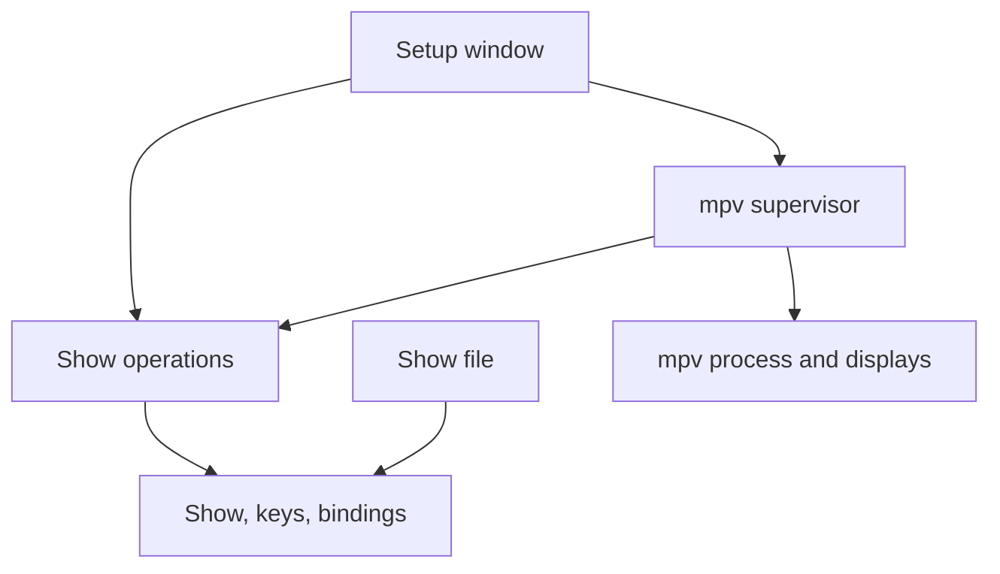

# Architecture

dee-nice is a workspace with a headless core and a desktop shell. The core owns the show. The shell owns the setup window, the monitor list, and the mpv process. The core does not depend on a GUI toolkit or on mpv.

## Crates

| Path | Owns |
| --- | --- |
| `crates/dee-nice-core` | The show, validation, playback bindings, and the versioned show file |
| `apps/desktop` | The setup window, the display list, and the mpv supervisor |

`unsafe` is forbidden in both crates. Playback stays outside the core so that can remain true: the shell supervises the `mpv` binary over its IPC socket and a generated input map. libmpv would pull FFI and unsafe into the app for no gain in this version. mpv already hardware-decodes, loops, fullscreens onto a chosen screen, and hard-cuts with `loadfile replace`.

The setup window is egui in `apps/desktop`. It lists the folder, edits the show through the core API, and starts display mode. See `docs/ui.md`.

Lock and exit are in the mpv input file from the start, so Ctrl+Shift+K still quits if IPC never connects. Clip keys are sent with `define-section dee-nice-clips … force` and removed with `disable-section`. `load-input-conf` leaves keys that were already loaded, so the session does not use it to lock. The section needs the `force` flag; without it mpv accepts the section and then ignores its keys. The shell passes `--screen-name` and `--fs-screen-name` only. A numeric screen index would override the name, and mpv's index is not the index stored on the show.

## Show

`Show` is the document. Fields are private to callers outside the core. Edits go through methods, and a rejected edit leaves the previous show in place.

| Operation | Behavior |
| --- | --- |
| `set_template` | Full, side by side, stacked, four, or portraits. A key whose slot is not in the new layout moves to the first slot. |
| `assign` / `assign_black` / `clear` | One clip path or black per key, in one slot of the current layout. Absolute paths and `..` are rejected. A slot the layout does not have is rejected. Black has no file. |
| `set_key_name` | A short name on an assigned key, 24 characters or fewer. An empty name clears it. A rejected name leaves the previous one. |
| `set_muted` | Durable mute flag. The shell applies it when display mode starts. |
| `set_start_locked` | The lock copied into the session when display mode starts. |
| `set_auto_lock_seconds` | `None` is off. A value from 1 second through 24 hours locks clip keys after that much idle time. The setup window writes 60 seconds. |
| `set_output_display` | Monitor name plus index, kept in memory for the session. Empty names are rejected. The shell stores it in `machine.json`, not in the show file. |
| `playback_bindings(locked)` | Play or black bindings for each assignment, including its slot, then Ctrl+Shift+L and Ctrl+Shift+K. A locked session omits the play and black bindings and keeps both chords. |

`start_locked` is not the live lock. The shell holds the session lock. Clip keys always come from the unlocked bindings, and `start_locked` decides whether that section starts enabled.

The setup keyboard offers `a`–`z` and `0`–`9`, in keyboard order. The show file still accepts `f1`–`f12`, `space`, and the arrow keys, so an older file opens and those keys still play. Names in the file are lowercase. The plain K and L keys can still play clips, because lock and exit require Ctrl and Shift. Thumbnails are shell-only previews in Application Support. Assigning a key still goes through `Show`.

## Show file

Schema version 4. JSON, at `<media>/.dee-nice/show.json`. The file holds the layout, the key map, each key's slot, names, black keys, mute, start locked, and auto-lock. It does not hold the media path or the display: the folder that contains `.dee-nice` is the media folder, and the shell remembers the display per folder. Unknown fields are rejected. Schema 5 or newer is rejected before the rest of the file is interpreted. Schema 3 still loads as a full-screen layout. Schema 2 still loads as a clip map without names, black keys, or auto-lock. Schema 1, the older Application Support file, still loads so it can be copied into the folder. The writer saves to a temporary file in the same directory and replaces the destination only after the temp file is flushed. A failed replace leaves the previous file.

A full layout is one fullscreen mpv, and its keys load the file directly. A divided layout keeps a black fullscreen backdrop for the keyboard and opens one borderless mpv window per slot. A key reports which slot it is, and the session hard-cuts only that window. The backdrop uses mpv's own fullscreen, not a separate macOS space, so the slot windows can sit on top of it.

The shell must refuse display mode when no output display is chosen, when an assigned file is missing, or when mpv cannot start. Those checks do not belong in the file loader: a show still has to open so the operator can fix it.

While display mode is running, the shell starts `caffeinate` against the mpv process so the display stays on and the Mac does not idle-sleep. The assertion ends when that process does. A missing `caffeinate` does not block the show.

`machine.json` also stores `presentation`. A missing value means kiosk. The show file does not store it, so copying a video folder onto a kiosk does not turn presentation on.

## Where the next change goes

| Change | Start here |
| --- | --- |
| A new show edit or rule | `Show` in `crates/dee-nice-core/src/show.rs`, with a unit test |
| A new durable field | `FileShow` in `persist.rs`. Destructuring is exhaustive on purpose. Add a round trip and a rejection test. |
| The setup window | `apps/desktop/src/app.rs`. Call the core methods. Do not keep a second copy of the key map. |
| Display mode | `apps/desktop/src/session.rs` and `playback.rs`. Translate key names there: core `space` is mpv `SPACE`, core `f1` is mpv `F1`, and Ctrl+Shift+K is `ctrl+K`. |
| A lighter derivative | `apps/desktop/src/derivatives.rs`, following `docs/derivatives.md`. ffmpeg writes into the Application Support cache. The core keeps storing a relative clip path. |

Monitor enumeration and the folder scan stay in the shell. The core stores the operator's choice and the relative paths.

The shipping app is a macOS bundle, built by `scripts/bundle-macos.sh` into `dist/dee-nice.app`. Finder shows one icon. Inside `Contents/MacOS`, next to `dee-nice`, are `ffmpeg`, `ffprobe`, and a nested `mpv.app`. ffmpeg's libraries sit in `Contents/lib`, which is where that ffmpeg build already looks. mpv keeps its own libraries inside `mpv.app`. They are still separate processes. They are not linked into the Rust binary. `Contents/Resources` holds the GPL text and the notices for mpv and ffmpeg.

The shell resolves a bundled tool first, then `DEE_NICE_MPV`, `DEE_NICE_FFMPEG`, or `DEE_NICE_FFPROBE`, then `PATH`. `PATH` is a developer fallback. `cargo run` has no sibling tools, so the overrides still apply there.
